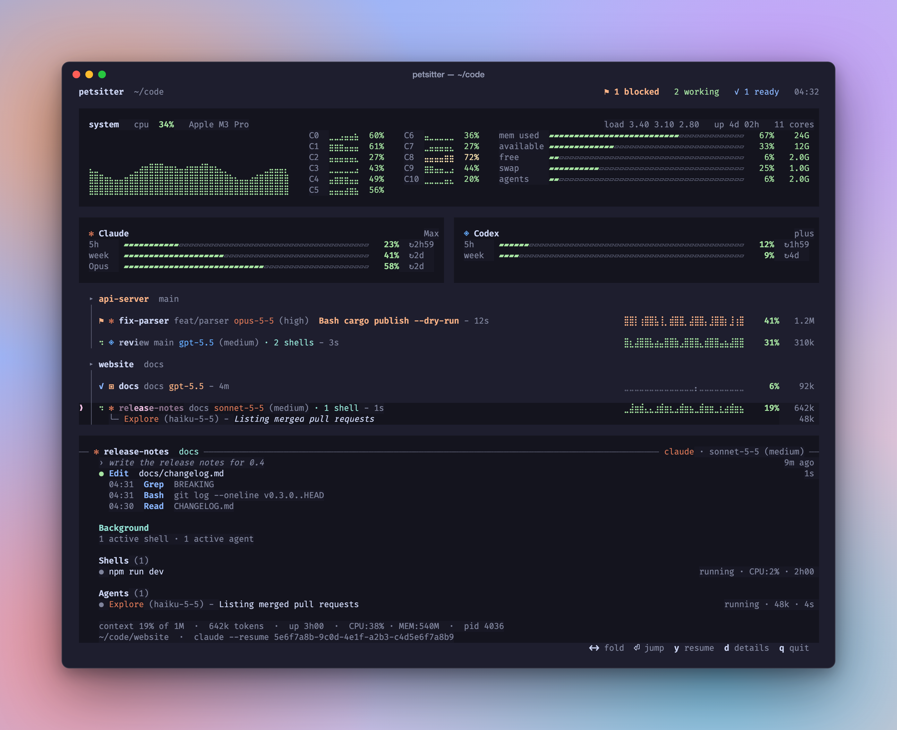

<div align="center">

# 🐾 petsitter

**Your AI coding agents are pets. Walk them all on one leash.**

A live terminal view of every **Claude Code**, **Codex** and **opencode**
session in a folder: who is working, who is waiting for you, who fell
asleep, and what each one is up to.

[](https://github.com/reremint/petsitter/actions/workflows/ci.yml)
[](LICENSE)

</div>

<p align="center">
  
</p>

## Install

```sh
curl -LsSf https://github.com/reremint/petsitter/releases/latest/download/petsitter-installer.sh | sh
```

That's it. Then, from the folder that holds your projects:

```sh
petsitter
```

<sub>macOS and Linux. With Rust instead: `cargo install petsitter --locked`.</sub>

## What you see

- **Every session, live**, in a tree of the folders they run in. Sessions in a
  git worktree sit under their repository.
- **Its state at a glance**: ⚑ blocked on you (a permission prompt or a
  question), working, ✓ your turn, ○ quiet. Blocked ones come first.
- **What it is doing**: model and effort, background shells, sub-agents,
  context used, tokens spent, and its activity over the last ten minutes.
- **Your quotas**: the 5-hour, weekly and per-model limits of each account,
  with when they reset.
- **Details on demand**: select a session for its last prompt, commands,
  shells and agents; select a git folder for the branches your sessions work
  on, then click a commit to read its diff.

## Keys

| Key | |
| --- | --- |
| `↑` `↓` | Select |
| `→` `←` | Open / close a folder |
| `⏎` | Jump to the session's terminal pane (in the Rex terminal) |
| `y` | Copy the command that resumes the session |
| `h` | Show / hide exited sessions |
| `d` | Show / hide the details |
| `Ctrl+X` twice | Delete an exited session |
| `q` | Quit |

The mouse works too: click to select, scroll to browse, click a commit to
see what it changed.

## Good to know

- **Local.** petsitter reads the files your agents keep on disk and the
  process table, and sends nothing anywhere: its only network requests go to
  opencode's own service on `127.0.0.1`. It changes nothing either, unless you
  delete an exited session (Claude Code transcripts go to the trash; Codex and
  opencode delete through their own commands).
- **Fits your terminal's theme**, light or dark, and honors `NO_COLOR`.
- **Options**: `petsitter --help`. A different folder: `petsitter ~/work`.
- **Man pages**: `petsitter man ~/.local/share/man/man1` installs them, then
  `man petsitter` works (with `cargo install`: `~/.cargo/share/man/man1`).

<details>
<summary><b>Optional: fresher Claude quotas, and Codex approval prompts</b></summary>

<br>

Claude Code refreshes the quotas it caches only when you run `/usage`, but it
sends fresh ones to its status line after every reply. Let petsitter listen
in, without changing how your status line looks:

```sh
petsitter hooks install claude
```

Codex does not record when it waits for an approval. A small hook tells
petsitter:

```sh
petsitter hooks install codex
```

`petsitter hooks uninstall <agent>` removes either one, and `petsitter doctor`
shows what is set up.

</details>

## Contributing

Bug reports and pull requests are welcome: see
[CONTRIBUTING.md](CONTRIBUTING.md).

## License

[MIT](LICENSE)
